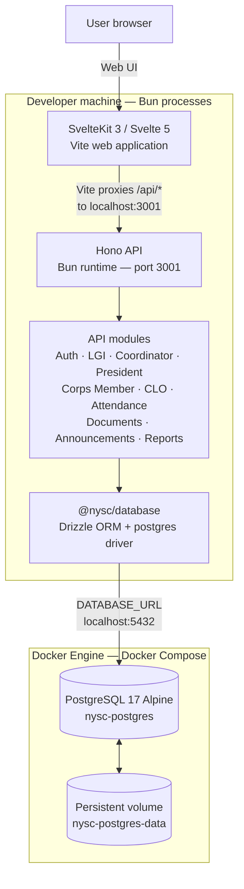

# NYSC CDS Management Platform

A role-based platform for managing NYSC Community Development Service (CDS) operations, corps-member allocation, meetings, attendance and monthly readiness.

## Architecture overview

The platform is a **Bun workspaces monorepo** with a SvelteKit web application, a Hono API and a shared Drizzle database package.

| Layer | Technology | Responsibility |
|---|---|---|
| Web application | SvelteKit 3, Svelte 5, Vite | Role-based user interfaces and browser navigation |
| API runtime | Hono on Bun | HTTP routes, authentication, validation, authorization and business rules |
| Data access | Drizzle ORM, `postgres` driver | Typed queries and PostgreSQL access, shared through `@nysc/database` |
| Database | PostgreSQL 17 | Accounts, role assignments, CDS groups, meetings, attendance, documents, announcements and operational records |
| Local infrastructure | Docker Compose | Runs the PostgreSQL container and its persistent named volume |
| Workspace tooling | Bun | Installs dependencies and runs the web and API development processes |

### System architecture

The diagram below shows the **current local development topology**. It distinguishes the Dockerized database from the web and API processes, which currently run through Bun on the developer's machine.



### Important Docker and runtime detail

- `docker-compose.yml` currently defines **one service: PostgreSQL 17 Alpine**. Docker Compose does not currently start the SvelteKit frontend or Hono API.
- The database container is published on `127.0.0.1:5432`, allowing the local API to connect through `DATABASE_URL`.
- The named volume `nysc-postgres-data` keeps database files across container restarts and normal `docker compose down` operations.
- The API runs locally through `bun run dev:api` on port `3001`.
- The frontend runs locally through `bun run dev:web`. Vite forwards requests beginning with `/api` to `http://localhost:3001` and strips the `/api` prefix.
- Full application containerization and production deployment topology are separate work; this diagram does not imply that the web and API services are already Dockerized.

### Repository layout

| Path | Contents |
|---|---|
| `apps/web` | SvelteKit application, role-based pages and shared UI components |
| `apps/api` | Hono API entry point, route modules, middleware and application services |
| `packages/database` | Drizzle client, PostgreSQL schema, migrations and development seed |
| `docker-compose.yml` | Local PostgreSQL container and persistent volume |
| `.env.example` | Environment-variable template for local development and optional providers |

The API is a modular monolith. The browser presents the interface, but the API remains responsible for authentication, authorization, data validation and business rules. Protected operations must enforce role and resource scope on the server; hiding a button in the browser is not an authorization check.

## Role model

| Role | Scope and responsibilities |
|---|---|
| LGI Administrator | Manages assigned LGA operations: Corps Member records, service years, batches, streams, CDS groups, shared course catalogue, Coordinator accounts, CLO assignments, document requirements, reports and monthly clearance. |
| CDS Coordinator | Manages only assigned CDS groups, member rosters, President designations, WhatsApp group settings, CDS meetings, attendance review and Coordinator announcements. |
| CDS President | Works only with group(s) attached to an active President assignment; coordinates the group, records attendance and submits eligible announcements for review. |
| Corps Member | Uses one personal account to manage their member portal, view NYSC/CDS allocation and contacts, submit required documents, join the assigned WhatsApp group and view approved attendance. |
| Corps Liaison Officer (CLO) | Reviews Corps Member document submissions and records verification or resubmission decisions within configured document-review access. |

Role assignments must be scoped. In particular, a CDS President assignment is tied to a CDS group; it is not a global permission. LGI administrators manage LGA operational records only within their assigned LGA(s). The shared academic course catalogue is centrally managed from the LGI module and is used across LGAs.

A person who is both a Corps Member and CDS President uses **one account** with multiple role assignments. The President role does not create a duplicate Corps Member record. Removing the President role must not disable the underlying Corps Member account.

## Account administration workflow

1. An LGI administrator creates/invites a CDS Coordinator and assigns one or more CDS groups within the LGI's scope.
2. The Coordinator activates their account using the invitation flow.
3. The Coordinator selects an existing active Corps Member from one of their assigned groups and designates that member as CDS President.
4. If the selected member has not activated their portal account, the President designation can remain pending until account activation.
5. President replacements are confirmed and recorded in designation history, including the reason supplied by the Coordinator.
6. LGI administrators manage Coordinator account status, group transfers and handovers. A successor can review and acknowledge transferred group responsibilities.
7. LGI administrators create CLO access and configure the LGA coverage used for document handling.

A Corps Member must not receive a duplicate person/account record when designated President. Disabling a Coordinator must preserve historical attendance, meetings, handovers and audit records.

## Responsive design requirements

Responsive behaviour is a project-wide acceptance requirement, not a post-launch enhancement.

| Target | Width | Expected behaviour |
|---|---:|---|
| Small mobile | 360–390 px | Single-column content, compact header, drawer navigation, no page-level horizontal overflow |
| Large mobile | 391–430 px | Single-column content with appropriately sized cards and controls |
| Tablet | 768–1024 px | Adaptive navigation and two-column content where it fits |
| Laptop | 1280–1440 px | Full dashboard navigation and multi-column summaries |
| Wide desktop | 1600 px and above | Expanded layout with readable maximum content width |

Responsive acceptance checks:
- Login forms fit narrow screens; inputs and primary actions are touch-friendly.
- LGI navigation collapses into an accessible mobile drawer.
- Dashboard cards reflow without clipping.
- Data tables use a deliberate mobile treatment (horizontal scroll within the table region or stacked record cards), never page-wide overflow.
- Dialogs, forms, validation messages and action menus remain usable on touch screens.
- Keyboard navigation, visible focus, semantic labels and sufficient contrast are maintained.
- Test at 360, 375, 390, 430, 768, 1024, 1280 and 1440 CSS pixels.

## Implemented workspace capabilities

The following describes functional areas present in the current development branch. Production readiness still depends on provider configuration, deployment, security review and end-to-end testing.

| Workspace / area | Implemented functionality |
|---|---|
| LGI administration | Manage service years, batches, streams, Corps Member records, CDS groups, membership, Coordinator accounts and group assignments. |
| Shared course catalogue | Manage course categories, canonical course names and aliases; import course data from CSV; use the searchable catalogue when mapping courses to CDS groups. |
| Coordinator management | Invite and manage Coordinators, transfer group responsibility, maintain handover records and review successor acknowledgements. |
| CLO management | Create/manage CLO access and configured LGA assignments; publish document requirements and review document-submission workflows. |
| Coordinator workspace | View assigned CDS groups and members; designate or replace a President from existing group members; manage the group's WhatsApp invite link and optional WhatsApp assistant. |
| CDS President workspace | View assigned group(s) and member roster; open meeting registers, mark members present/absent/late/excused and submit the completed register. |
| Attendance management | Coordinators schedule CDS meetings, inspect submitted registers, approve attendance or return it for correction with review notes. Returned registers can be corrected and resubmitted. LGI attendance reporting is read-only. |
| Corps Member portal | View NYSC profile details, group assignment, contacts, document checklist, WhatsApp access and approved attendance history. A dual-role member can move to the President workspace without creating a second account. |
| Document handling | Corps Members submit required documents; authorised reviewers can verify submissions or request resubmission. Manual review is the default document-verification mode. |
| Announcements and notifications | Role-based announcement workflows and a shared notification centre with unread counts and mark-all-read behaviour. |
| Reports and monthly clearance | LGI attendance analytics/reporting and monthly-clearance workflows, with scoped Coordinator visibility where applicable. |

### Attendance lifecycle

1. The Coordinator schedules a meeting for an assigned CDS group.
2. The President opens the register and records each member as present, absent, late or excused.
3. The President submits the completed register. A submitted register is locked while awaiting review.
4. The Coordinator approves the register or returns it with a correction note.
5. A returned register can be updated by the President and submitted again. An approved register is locked and its approved attendance is visible in the Corps Member portal.

### Documents and announcements

- LGI administrators configure and publish the document requirements used by Corps Members.
- Corps Members upload the requested documents through their portal.
- CLO reviewers handle submissions within their configured access and record verification or a reason for resubmission.
- LGI administrators and Coordinators publish announcements to selected groups through their respective workflows. President announcements are subject to Coordinator review before publication.
- The notification bell provides a shared place for authenticated users to see relevant unread notifications.

### WhatsApp group access

A Coordinator manages the invite link for each assigned CDS group and can optionally designate one group member as its WhatsApp assistant. Eligible Corps Members assigned to that group see the Join WhatsApp Group action in their portal. Coordinators can change or remove the link and assistant for their own assigned groups.

## Account recovery status

The database schema includes the `password_reset` token purpose and `auth_tokens` table, but the complete self-service password-recovery flow is **not yet available as a production-ready feature**. The reset UI, delivery integration, single-use token handling and end-to-end tests must be completed and verified before it is presented as an available production feature.

When implemented, recovery must use generic responses, short-lived single-use hashed tokens, rate limits, transactional token consumption and session revocation. A password reset must never reactivate a disabled or suspended account. Recovery of an LGI account whose registered email is inaccessible requires an authorised, identity-verified and audited administrative process.

## Security and integrity requirements

- Server-side role and resource-scope checks on every protected operation.
- Argon2id password hashing and opaque, hashed session tokens.
- Single-use, expiring activation tokens.
- Coordinator disablement revokes existing sessions.
- Database constraints and transactions protect unique assignments and group capacity.
- Audit records retain administrative changes and historical attendance.
- Biometric identity verification, if introduced, requires privacy review, secure processing, consent/lawful-basis analysis, retention limits, liveness/PAD and empirical threshold calibration. Use synthetic data during development.

## Development status and production readiness

### Implemented in the development branch

- Role-scoped authentication, account activation and PostgreSQL-backed sessions.
- LGI administration for cohorts, Corps Member records, CDS groups, course catalogue, Coordinator and CLO management.
- Coordinator group operations, President designation/replacement, WhatsApp group management, meetings and attendance review.
- CDS President attendance recording and announcement workflows.
- Corps Member portal, NYSC cohort/profile details, document submission and approved attendance history.
- CLO document review, announcement/notification workflows, LGI reports and monthly-clearance screens.
- Responsive layouts and mobile navigation across the role workspaces.

These features are being developed and validated incrementally. A feature being present in the development branch does not by itself mean its provider integrations, accessibility review, browser coverage or production operations are complete.

### Remaining deployment and verification work

- Configure and verify real email/SMS delivery providers for onboarding and other flows that require external delivery. The example configuration defaults `OTP_DELIVERY_MODE=console` for local development.
- Complete and validate Coordinator invitation email delivery where required.
- Configure persistent, encrypted and access-restricted storage for uploaded profile photos and documents. The example paths under `.data/` are local-development defaults.
- Keep document verification in manual mode unless AI mode, its API key, privacy controls and fallback behaviour have been deliberately configured and tested.
- Complete automated integration tests and browser acceptance testing across the responsive viewport widths listed above.
- Complete the self-service password-recovery flow before describing it as available.
- Define and test the production hosting topology, secrets management, database backups, monitoring and recovery procedures. The current Compose file is a local PostgreSQL setup, not a full production deployment.

## CDS Coordinator management

LGI administrators manage Coordinator invitations, group assignments, account disable/reactivate and session revocation from `/lgi/coordinators`. A Coordinator can be assigned to multiple groups within the LGI's assigned LGA scope; active group responsibility is explicitly assigned.

For a unit-level resignation or replacement, the LGI can create or assign a successor, transfer a CDS group, record pending activities, upcoming events and outstanding tasks, and require the successor to acknowledge the handover from `/coordinator/handovers`. Group membership and historical records remain with the CDS group.

Within assigned groups, Coordinators can view the member roster, designate or replace a CDS President from existing members, manage WhatsApp group settings, schedule meetings, review attendance registers, publish announcements and work with group-scoped monthly-clearance information. President designation history is retained. See [Coordinator Management documentation](docs/coordinator-management.md) for lifecycle rules, handover details and remaining email-delivery work.

## Shared course catalogue

The shared academic course catalogue is managed from the existing LGI administration module at `/lgi/course-catalogue`. LGI administrators can add, edit, deactivate/reactivate and bulk-import courses. These changes apply to the shared catalogue used by all LGAs. It supports discipline categories, canonical course names, aliases and CSV import. The development starter catalogue is representative, not exhaustive or an official national list. See [Course Catalogue documentation](docs/course-catalogue.md) for the API, CSV format, bootstrap and security rules.

## CDS group allocation algorithm

The platform uses a **rule-based, constraint-aware greedy allocation process with least-utilised-first load balancing**. These are three complementary algorithmic techniques working together in one automatic allocation flow, not three separate allocation services.

### 1. Rule-based eligibility filtering

Before an automatic assignment is considered, the system checks the Corps Member and the available CDS groups against explicit business rules:

- The Corps Member record must exist, must not have a rejected profile and must have an academic course recorded.
- The LGA must have active document requirements, including at least one active mandatory requirement. The latest submission for every active mandatory requirement must have a `verified` status.
- The Corps Member must not already have an active CDS group membership.
- A candidate CDS group must be active, belong to the Corps Member's LGA and have an exact course-ID mapping for the Corps Member's recorded course.
- A group previously cancelled by that Corps Member is excluded from their automatic candidate list.
- The candidate group must have at least one available seat.

The LGI configures course eligibility by mapping catalogue courses to each CDS group. Matching uses the stored course IDs; it is not AI prediction, machine learning or fuzzy course-name matching.

### 2. Greedy group selection

After filtering, the system selects the best currently eligible group in one pass through the ordered candidates. It does not calculate a global assignment plan across all Corps Members. New members are allocated one at a time as their verification process completes.

### 3. Least-utilised-first load balancing

Eligible groups are ranked by capacity utilisation:

`utilisation = active members / maximum capacity`

The group with the lowest utilisation is selected first, helping distribute new members across groups instead of filling one group before considering others. Ties are resolved deterministically by:

1. Lower active-member count.
2. Earlier group creation date.
3. Group ID in ascending order.

The member and candidate groups are locked within the database transaction during matching to reduce the risk of concurrent registrations taking the same final seat. The selected membership is recorded with an automatic assignment source.

### LGI manual placement and course-mapping override

LGI administrators can also place a Corps Member into a selected group through the manual assignment workflow. The system still enforces LGA scope, active group status, mandatory-document verification, one active membership per Corps Member and group capacity. The member's course must match the group's mapped course unless an authorised LGI explicitly uses the course-mapping override and supplies a reason of at least 10 characters. The override and reason are stored with the membership for traceability.

### Allocation outcomes

Automatic matching can return a clear outcome such as: member not found, course not recorded, document requirements not configured, documents incomplete, already assigned, no eligible group or all eligible groups full. This makes it possible for the application to explain why an automatic assignment did not take place instead of silently assigning a member to an unsuitable group.

## Local development

### Prerequisites

- Bun installed.
- Docker Engine and the Docker Compose plugin.
- Git.

### Configure environment

From the repository root:

```bash
cp .env.example .env
```

Review `.env` and set the PostgreSQL values and `DATABASE_URL`. The example file contains local placeholders; replace them before using the environment. Do not commit `.env` or real credentials.

### Start PostgreSQL with Docker Compose

```bash
docker compose up -d postgres
docker compose ps
```

Compose starts the PostgreSQL 17 Alpine container and attaches the persistent `nysc-postgres-data` volume. The database is exposed to the host on `127.0.0.1:5432`.

### Install, migrate and seed

```bash
bun install
bun run --filter @nysc/database db:migrate
bun run --filter @nysc/database db:seed
```

The seed is for development/testing. Do not load synthetic seed records into a production environment.

### Start the API and web application

Open separate terminals from the repository root.

Terminal 1 — Hono API on port `3001`:

```bash
bun run dev:api
```

Terminal 2 — SvelteKit/Vite frontend:

```bash
bun run dev:web
```

Vite proxies requests under `/api` to `http://localhost:3001`. The API connects to PostgreSQL using `DATABASE_URL`.

### Checks

```bash
bun run --filter @nysc/web check
bun run --filter @nysc/web build
bun run --filter @nysc/api typecheck
```

To stop the local database container without deleting its data:

```bash
docker compose stop postgres
```

Do not use `docker compose down -v` unless you intentionally want to delete the PostgreSQL volume and its local data.

## Next implementation sequence

1. Complete browser acceptance tests for all workspaces at 360, 375, 390, 430, 768, 1024, 1280 and 1440 CSS pixels.
2. Complete integration testing for attendance submission/review, document review/resubmission, Coordinator handovers and group-scoped authorization.
3. Configure and verify provider-backed email/SMS delivery and secure persistent upload storage.
4. Complete password recovery and production-grade operational controls, including database backups, monitoring and restore tests.
5. Design and validate the production deployment topology. Decide whether the web application and API should be containerized alongside PostgreSQL; the present Docker Compose configuration only runs the database.
