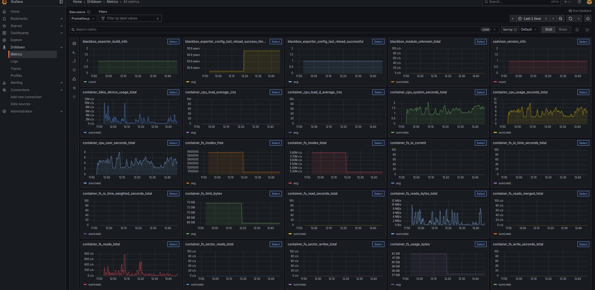

# Infrastructure Monitoring — Prometheus and Grafana

This guide describes the optional local monitoring stack provided by the Docker Compose `monitoring` profile. The configuration is tracked under `infrastructure/monitoring/` and is intended for the Ubuntu/Linux development environment.

## Start the monitoring stack

1. Ensure the repository root has a `.env` file. Keep the existing PostgreSQL values (`POSTGRES_DB`, `POSTGRES_USER`, `POSTGRES_PASSWORD`, and `DATABASE_URL`) unchanged. Add a unique `GRAFANA_ADMIN_PASSWORD` and, optionally, `GRAFANA_ADMIN_USER`.
2. Start the API on the host in a separate terminal so the Blackbox probes can reach it:

   ```bash
   bun run dev:api
   ```

3. Start PostgreSQL, Redis and the monitoring profile:

   ```bash
   docker compose --profile monitoring up -d
   ```

4. Open the local services:

   | Service | URL |
   |---|---|
   | Grafana | http://localhost:3000 |
   | Prometheus | http://localhost:9090 |
   | Prometheus targets | http://localhost:9090/targets |

Grafana uses `GRAFANA_ADMIN_USER` and `GRAFANA_ADMIN_PASSWORD` from `.env`. Change the example password before starting the monitoring profile. Grafana and Prometheus ports are bound to `127.0.0.1`, so this Compose configuration does not publish them to the LAN.

The API health probe targets use `host.docker.internal:3001`. They will show DOWN while the host API process is stopped. The current probes cover HTTP availability and database health; they are not application request-count or latency instrumentation.

## Stop monitoring

To stop only the monitoring services while leaving PostgreSQL and Redis running:

```bash
docker compose stop prometheus grafana postgres-exporter node-exporter cadvisor blackbox-exporter
```

To stop every container in this Compose project, including PostgreSQL, Redis and any active `app` profile containers:

```bash
docker compose --profile monitoring down
```

These commands do not remove named volumes. Do not add `-v` unless you intentionally want to delete the database, Prometheus and Grafana data volumes.

## Grafana folder and infrastructure dashboard

The provisioned Grafana folder contains **NYSC CDS Platform — Infrastructure Overview**.


The dashboard includes panels for API health, API database health, PostgreSQL exporter health, PostgreSQL connection counts, host CPU and memory usage, and container CPU and memory usage.


In the saved capture, the API, API database and PostgreSQL exporter health panels show `1` (the panel labels define `1 = UP`). The container CPU and memory panels show **No data** in that capture. This is a point-in-time image, not evidence that every metric is currently available.

## Prometheus target health

The saved Prometheus target-health screenshot shows these scrape pools:

- `blackbox-exporter`
- `cadvisor`
- `node`
- `nysc-api-health`
- `postgres`
- `prometheus`


Target state is time-dependent. In an active environment, refresh the page and inspect **Last scrape**, **State** and scrape error details rather than relying on the saved image.

## Metrics explorer

Grafana's metrics explorer screenshot shows the metric browser populated with container and exporter metric names, including CPU, filesystem and block-device metrics.



Check that a metric is present before adding it to a dashboard panel. An absent metric may mean that the relevant exporter is not running, is not being scraped or does not expose that metric.

## Operational limitations and follow-up work

- The API is monitored through HTTP probes, not application-level request, latency or error-rate metrics.
- The current API health probes target host port `3001` and are intended for the local `bun run dev:api` workflow. They do not automatically target the API container in the optional `app` profile.
- No alert rules or alert notification channels are provisioned yet.
- Production use still requires a reviewed access-control model, managed secrets, retention settings, and monitoring-data backup/restore procedures.
- Host and container exporters use Linux host mounts. This configuration is intended for a Linux host and may require adjustment on non-Linux Docker environments.
