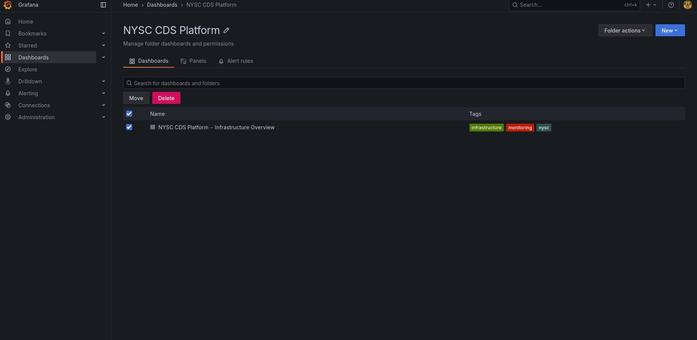
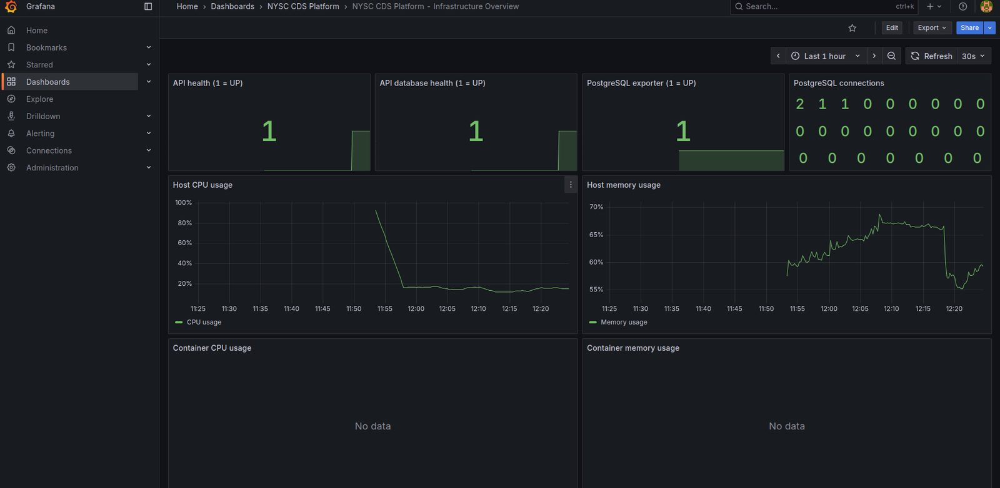
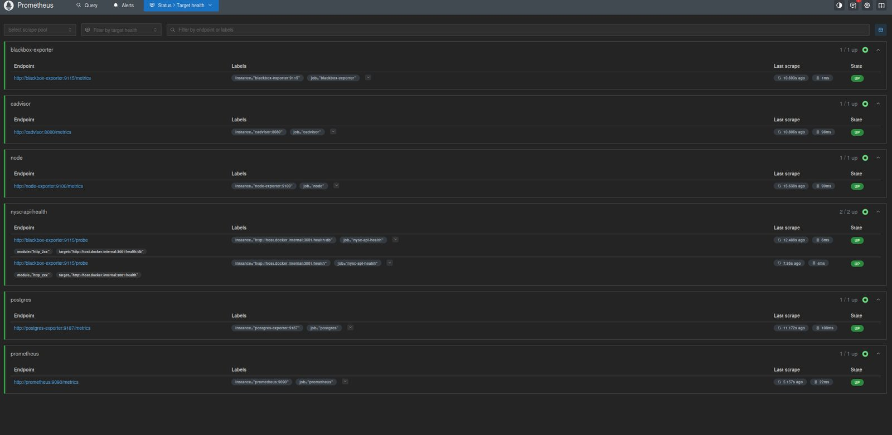

# Monitoring Views — Prometheus and Grafana

This page records the monitoring screens captured during local development and describes what they show. It is not yet a deployment runbook.

## Important repository limitation

As of the `feat/prometheus-grafana-monitoring` branch checked on 23 November 2026, the tracked repository contains:
- Docker Compose services for PostgreSQL and Redis.
- An optional `app` profile for the API, web application and Nginx.
- Health endpoints referenced by the API/container health checks: `/health`, `/health/db` and `/health/redis`.

The tracked `docker-compose.yml`, `docker-compose.override.yml` and repository tree do **not** currently include a Prometheus or Grafana service definition, Prometheus scrape configuration, Grafana provisioning files, Node Exporter, cAdvisor, Blackbox Exporter or PostgreSQL Exporter configuration. The screenshots below show a monitoring environment that was running locally during an earlier session; they do not establish that the monitoring stack can currently be recreated from this branch.

Do not use these screenshots as a live service-health check. They are dated reference captures.

## Grafana folder and infrastructure dashboard

The Grafana folder contains a dashboard named **NYSC CDS Platform – Infrastructure Overview**.

The overview dashboard screenshot includes panels for:
- API health.
- API database health.
- PostgreSQL exporter health.
- PostgreSQL connection counts.
- Host CPU usage and host memory usage.
- Container CPU and memory usage panels.

In the captured dashboard, the API, API database and PostgreSQL exporter health panels show `1` (the panel labels define `1 = UP`). The container CPU and memory panels show **No data** in that capture. This illustrates why dashboard panels must be checked individually; an overall page being visible does not mean every exporter is supplying metrics.

## Prometheus target health

The Prometheus target-health screenshot shows these scrape pools:
- `blackbox-exporter`
- `cadvisor`
- `node`
- `nysc-api-health`
- `postgres`
- `prometheus`

At the time of that capture, the displayed targets were UP, including two API health probe targets. Target state is time-dependent. In an active environment, refresh the page and check the **Last scrape**, **State** and scrape error details rather than relying on a saved image.

## Metrics explorer

Grafana's metrics explorer screenshot shows the metric browser populated with container and exporter metric names, including CPU, filesystem and block-device metrics.

Use the metrics explorer to check whether a metric is present before adding it to a dashboard panel. A metric that is absent may indicate that the relevant exporter is not running, not scraped, or not exposing that metric.

## Work still required before an operational monitoring runbook

The monitoring stack configuration needs to be added to the repository before this guide can provide reproducible startup and recovery commands. That work should include:
1. Versioned Compose service definitions for Prometheus, Grafana and each selected exporter.
2. Prometheus scrape configuration, health checks and persistent storage.
3. Grafana datasource and dashboard provisioning rather than relying only on manually created dashboards.
4. A clear mapping from each metric to the exporter that supplies it.
5. Alert rules for API availability, database health, exporter scrape failures, host resource pressure and Redis degradation.
6. Access control, secret handling, retention settings and a documented backup/restore approach for monitoring data.

Until those files are committed, treat Prometheus/Grafana as a local monitoring experiment and not part of the reproducible Compose stack documented in the main README.
