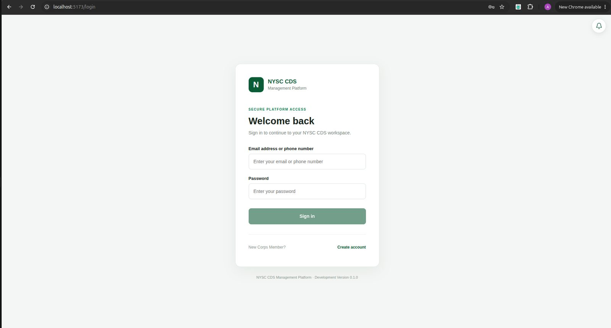
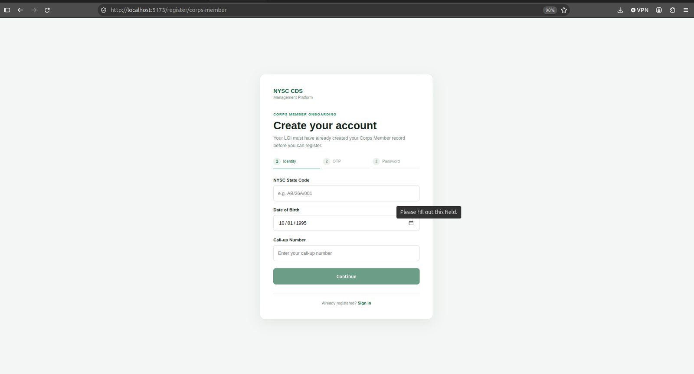
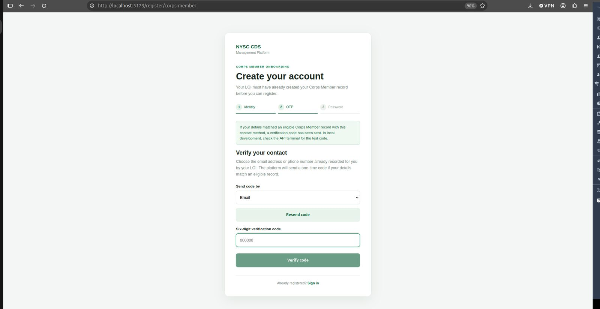
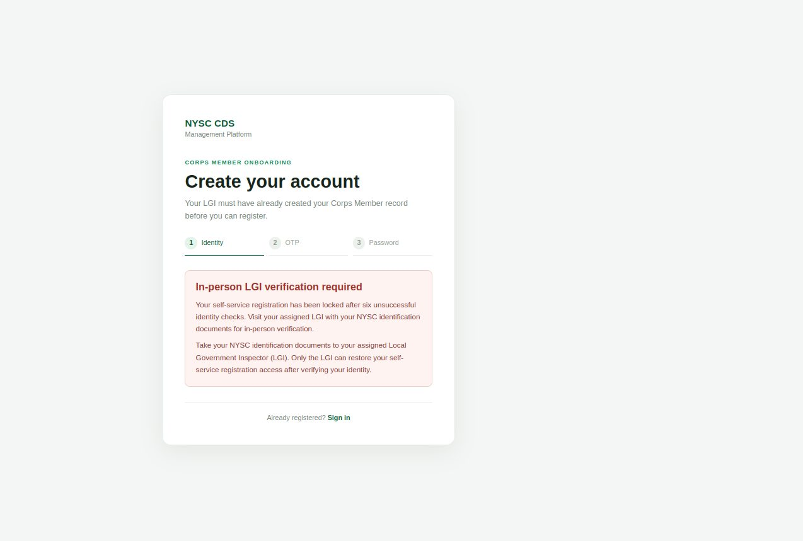

# Sign-in and Corps Member Registration

## Sign in

Open the platform's sign-in page at `/login`. Enter the email address or phone number associated with your account, enter your password, then select **Sign in**.

Your available workspace depends on the active role assignments on your account. A user who is both a Corps Member and a CDS President can use the President workspace and switch to the Corps Member portal without creating a second person record.

## First-time Corps Member registration

Self-service registration is available only after the LGI has created a matching Corps Member record. Contact your assigned LGI if you do not yet have a record or your details need correction.

The onboarding page is `/register/corps-member`. It has three steps.

### Step 1 — Verify NYSC identity

Enter all three details exactly as recorded by the LGI:

- NYSC State Code.
- Date of Birth.
- Call-up Number.

The platform checks the three values against the same eligible, unlinked Corps Member record. The record must have the `preloaded` profile status. A mismatch does not send an OTP and does not create an account.

### Step 2 — Verify contact

Choose the email address or phone number already recorded by the LGI. Request the one-time verification code, then enter the six-digit code.

The challenge token created during identity verification expires after 10 minutes. The OTP confirms access to the selected contact method; it is not a substitute for the initial NYSC identity match.

### Step 3 — Set a password

After the OTP is confirmed, create a password to finish registration. Keep it private and do not share it with the LGI, Coordinator or another Corps Member.

## Identity-check cooldown and lockout

The identity verification flow has additional abuse protection:

- Failed checks are tracked for the normalized State Code.
- The third failed check starts a five-minute cooldown.
- After the cooldown, three further failed checks (six failed checks overall) permanently lock self-service registration for that existing Corps Member record.
- A correct identity check resets the failed-attempt count only when the account is not already permanently locked.
- A permanently locked member must visit the assigned LGI with NYSC identification documents. Only an authorized LGI administrator assigned to that member's LGA can clear the lock after in-person verification.

The locked screen explains that an in-person LGI check is required.

The LGI clears an eligible member's lock from **Corps Members** using **Clear lock** / **Clear registration lock**. The action resets the count and cooldown and records the LGI identity and time. If the State Code does not identify an existing preloaded record, the request cannot be attached to a member record; confirm the correct State Code with the LGI.

For the precise backend limits and data handling, see [Corps Member onboarding and identity verification](../corps-members.md).

## Help

Contact the assigned LGI if:
- Your State Code, Date of Birth or Call-up Number does not match.
- The email address or phone number displayed for OTP is no longer accessible.
- Your profile is not eligible for self-service onboarding.
- Your registration is permanently locked.

Do not send passwords or one-time codes in email, group chat or support messages.
