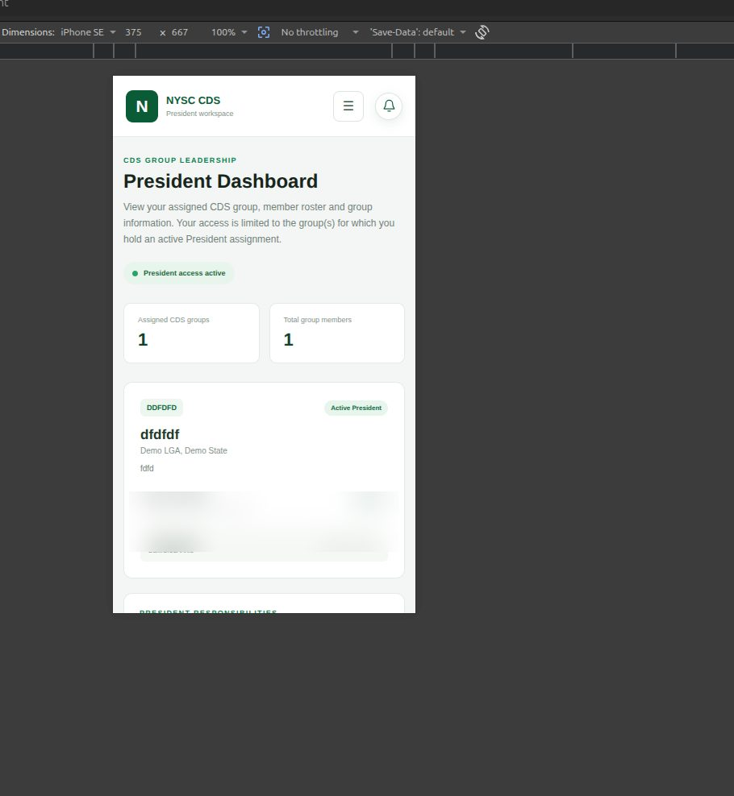
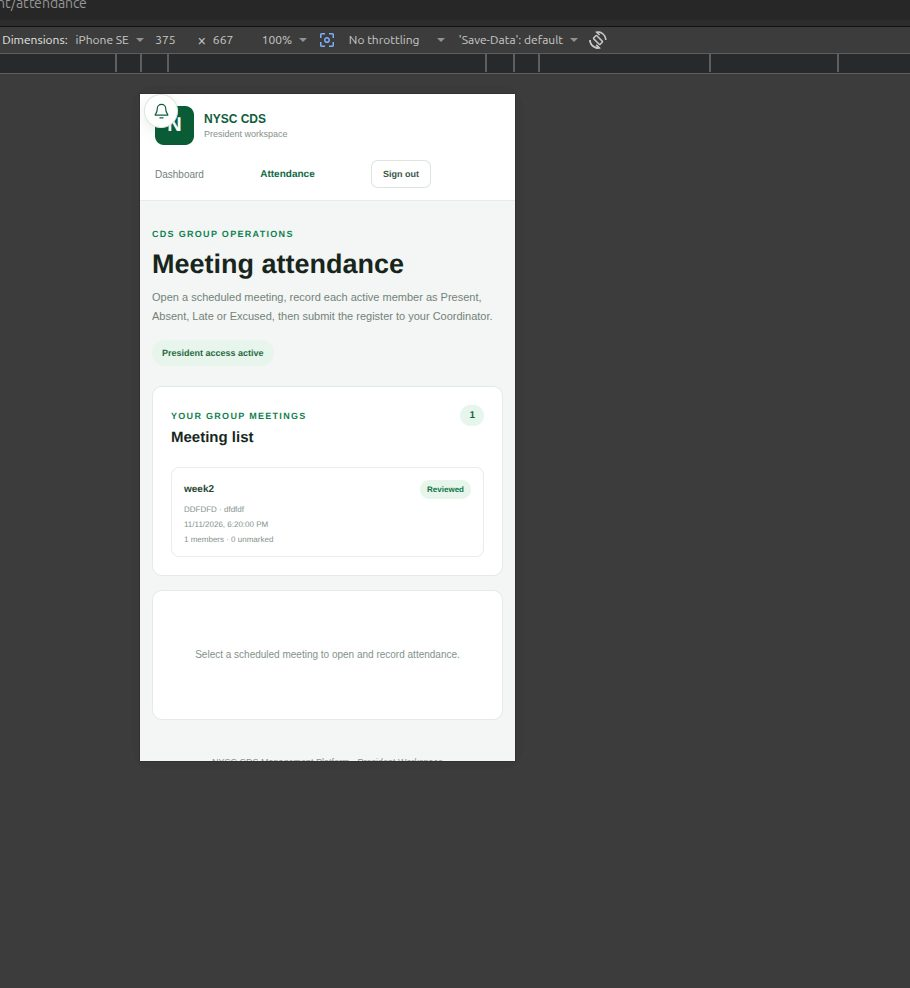
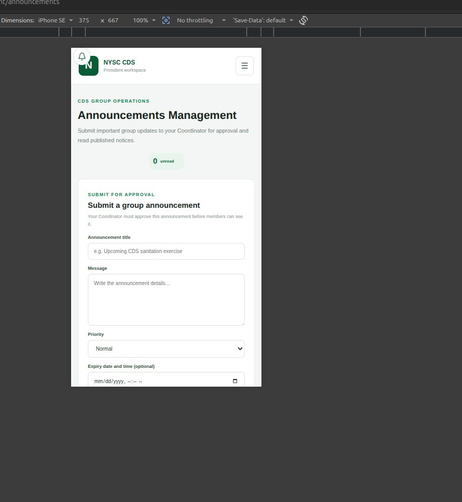

# CDS President Guide

The CDS President workspace is available at `/cds-president`. Access is limited to the group(s) for which your account has an active President assignment.

## President dashboard

The dashboard shows assigned CDS group information and the current member roster. It is a group-operations view: it does not give you LGI or Coordinator administration privileges.

A user who is both a CDS President and a Corps Member can open **Corps Member portal** from the President navigation. The two roles use one account and one member record.

## Record meeting attendance

Open **Attendance**, then select a scheduled meeting for your group.

Open the meeting register and mark each active roster member as:
- Present
- Absent
- Late
- Excused

Check the entries and submit the register to your Coordinator. The Coordinator may approve the register or return it for correction. You can correct and resubmit a returned register. An approved register is locked; approved attendance is then visible to Corps Members and in LGI attendance reports.

Do not submit an incomplete register. Follow your Coordinator's instructions if a member's status needs correction after submission.

## Submit an announcement

Open **Announcements** and complete the announcement form with a title and message. Set a priority and, where useful, an expiry date/time. Submit it for Coordinator approval.

Members do not see a President-submitted announcement until it is approved and published by the Coordinator. Check names, dates, locations and instructions before submission.

## Role boundaries

A CDS President cannot:
- Add or remove Corps Members from the group.
- Change a member's CDS group assignment.
- Designate or replace another President.
- Manage the LGA's document requirements or NYSC cohort records.
- Access groups outside the active President assignment.

Raise roster or assignment corrections with the Coordinator or LGI rather than attempting to change administrative records.
