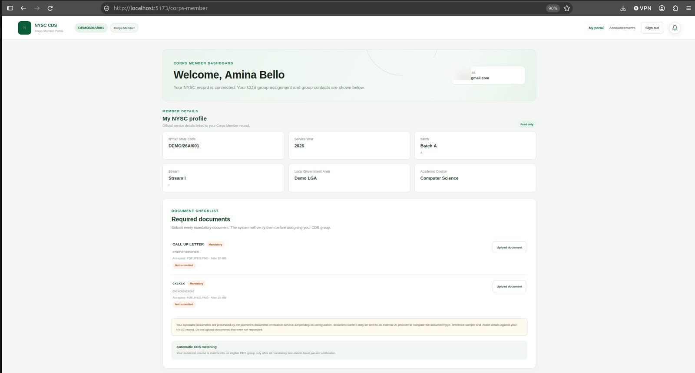
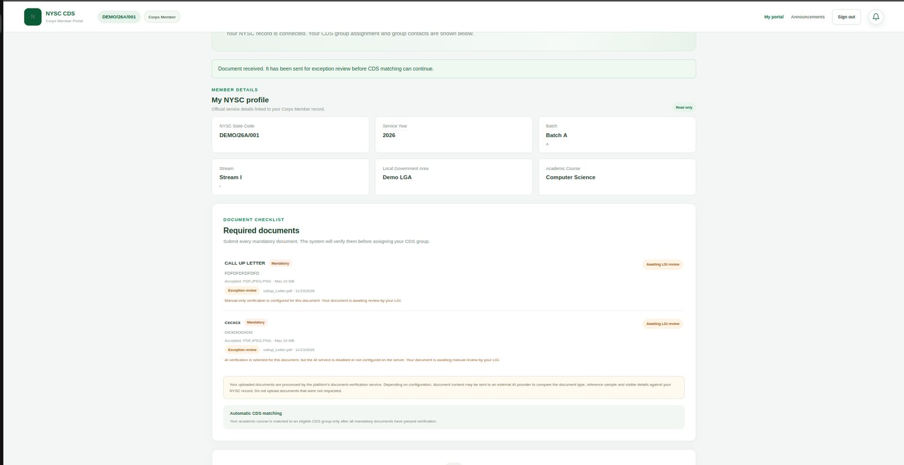
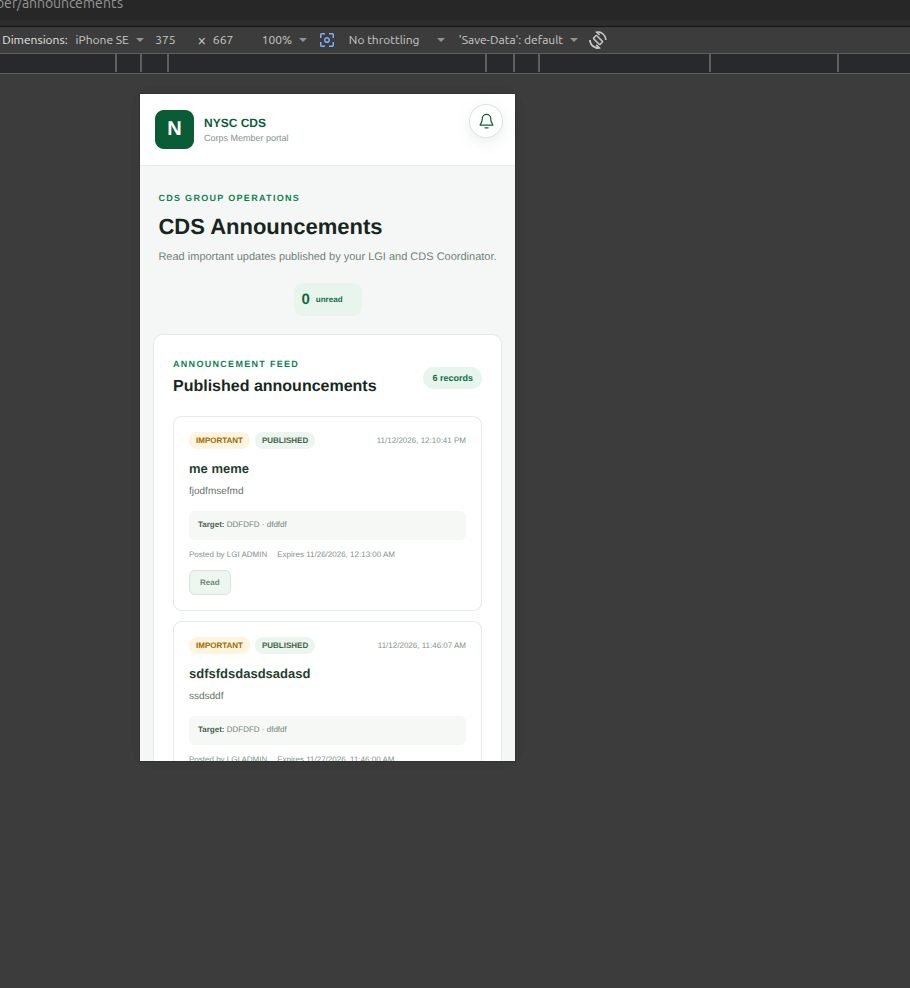

# Corps Member Guide

The Corps Member portal is available at `/corps-member`. It shows the NYSC record connected to your account and the CDS information available for that record.

## Portal overview

The dashboard includes your read-only NYSC profile information, required document checklist, CDS group assignment and group contacts, and approved attendance history where available.

## Submit required documents

Open **Required documents**. Read the requirement name, whether it is mandatory, accepted file types, maximum file size and current status. Select **Upload document** for the requested item and choose the correct file.

- Upload only documents requested by the LGI.
- Use an accepted PDF, JPEG or PNG file and stay within the size limit shown for that requirement.
- Do not upload a password-protected, unreadable or unrelated file.
- Keep the original file until the review is completed.

Possible outcomes include a verified submission, a request to resubmit, or a submission waiting for human review. Read the verification note below the item and follow the instructions. When a document is returned, upload a corrected copy for the same requirement.

Depending on the configured mode, a submission may be checked by AI, sent directly to manual review, or held for LGI approval. AI checking is not a guarantee that a document is authentic; the LGI/CLO reviewer remains responsible for any required human decision. See [Document Verification Workflow](../document-verification.md).

Automatic CDS matching is considered only after the active mandatory document requirements have verified latest submissions and the member's course maps to an eligible active group. Uploading one document does not guarantee immediate group placement.

## CDS group and WhatsApp

When you have a group assignment, the portal shows the group name, contacts and placement information. If the Coordinator has configured an invitation link, select **Join WhatsApp Group** to open the group's WhatsApp invitation.

If no link is available, contact your Coordinator; the portal will show that the invitation has not yet been added.

## Announcements

Open **Announcements** to read updates published by your LGI or CDS Coordinator. Use the notification controls to keep track of unread items.

## Attendance

Your attendance history is read-only. It shows attendance from approved CDS registers. If a mark appears incorrect, contact the CDS President or Coordinator so they can follow the correction process; the Corps Member portal does not edit an approved register.

## Keep your account safe

Sign out when using a shared device. Do not share your password or OTP. Contact the LGI if your NYSC profile details are incorrect or a required document is not listed.
