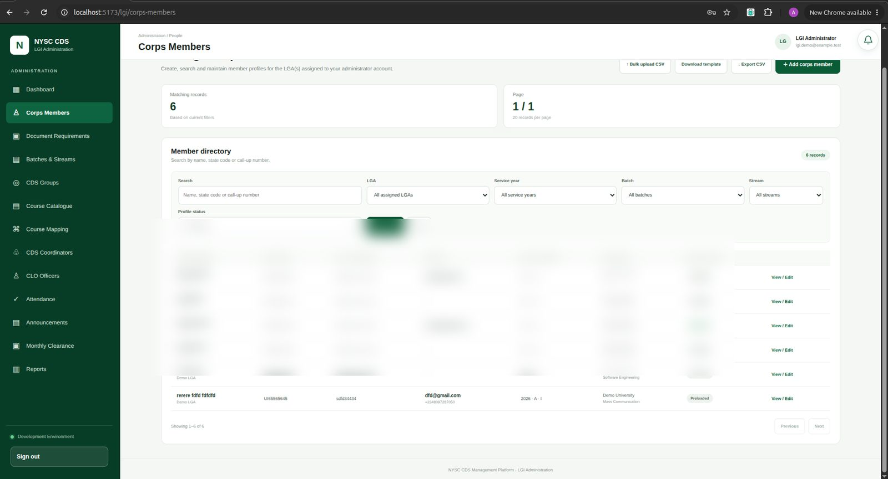
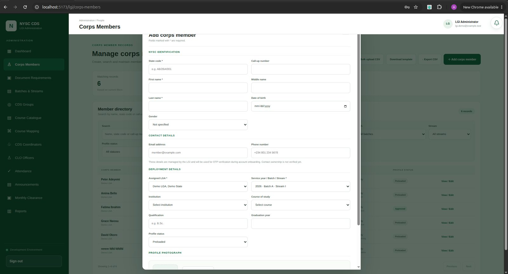
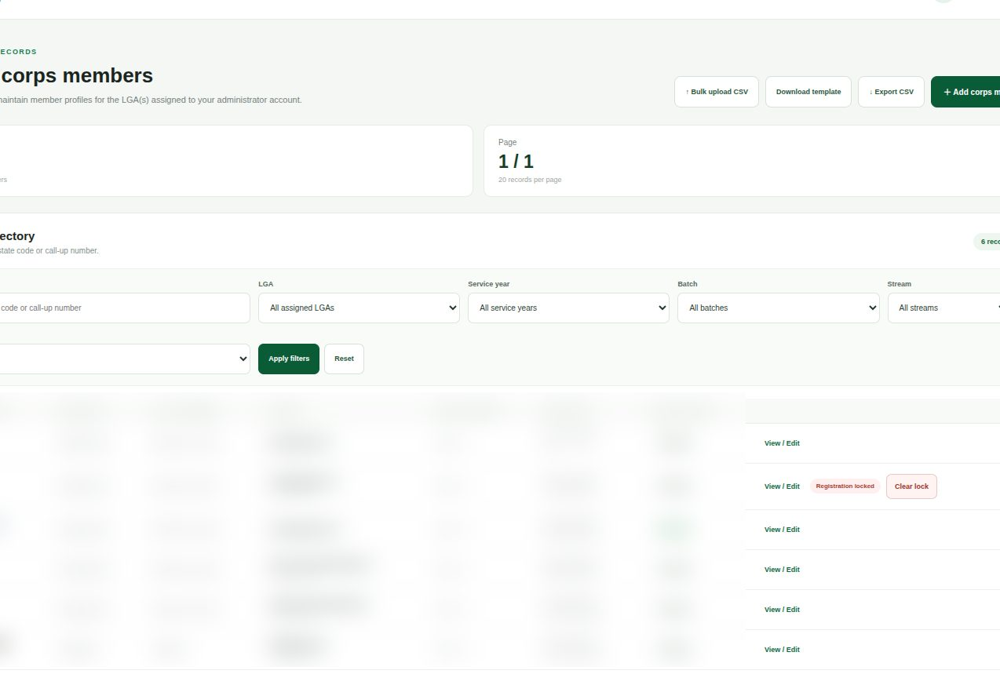
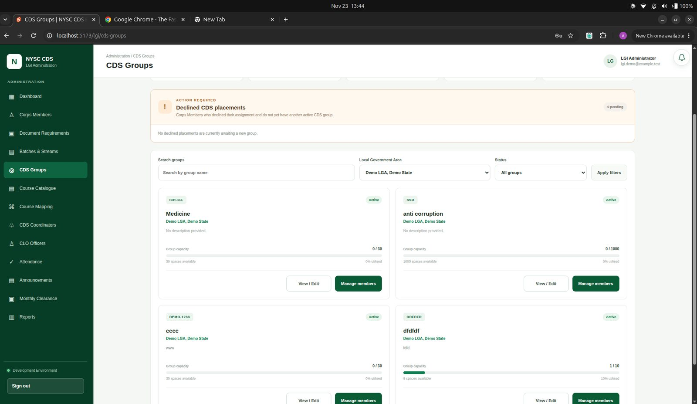
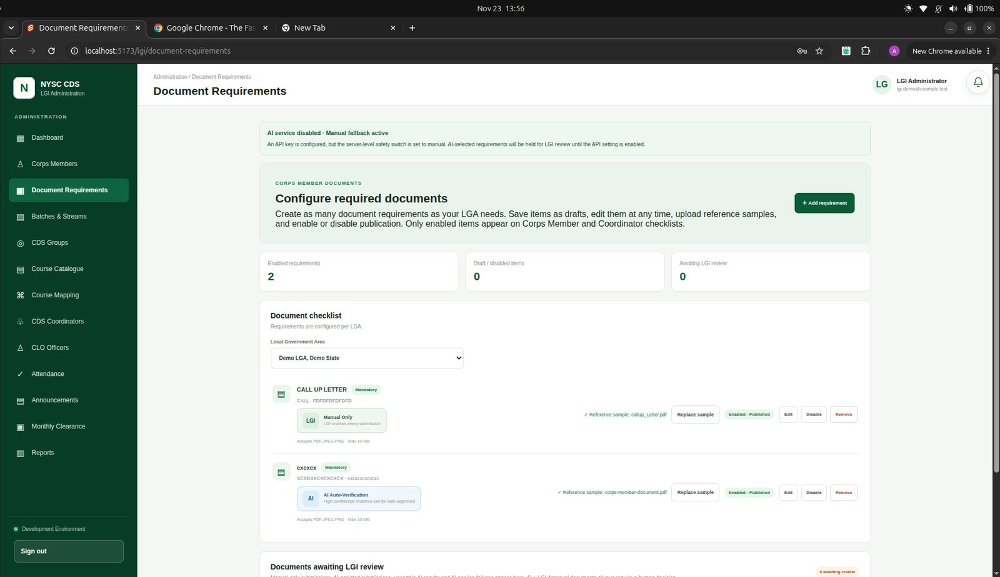
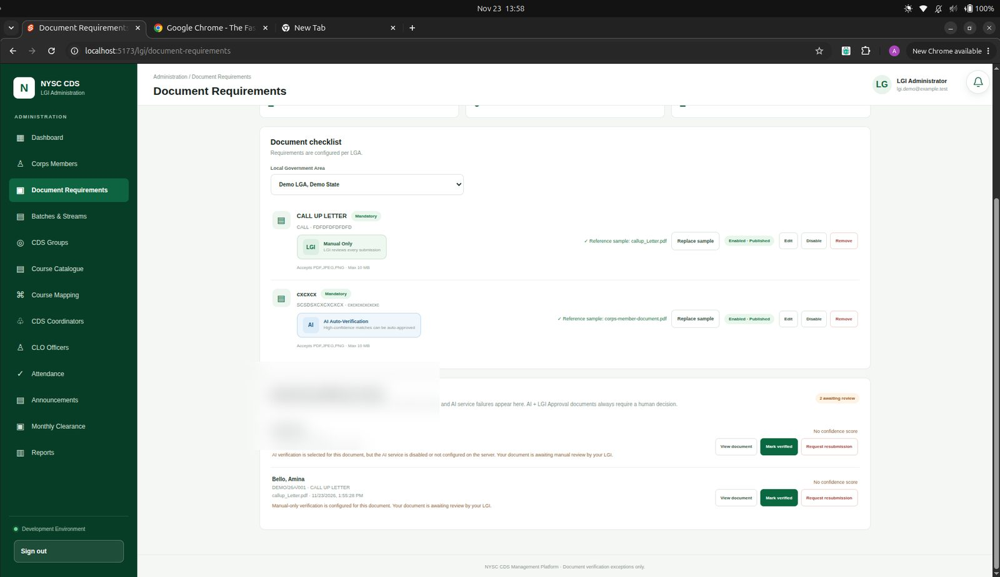
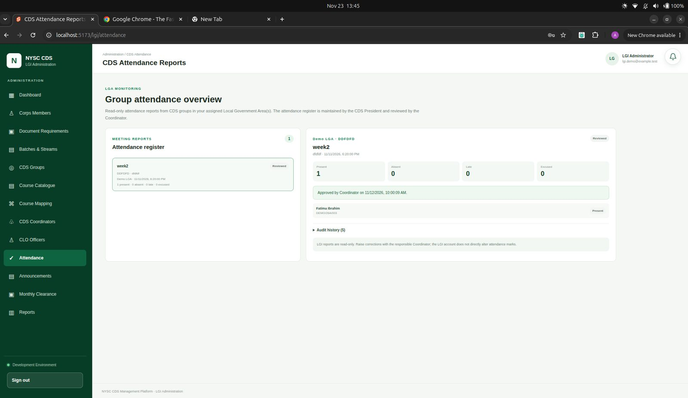
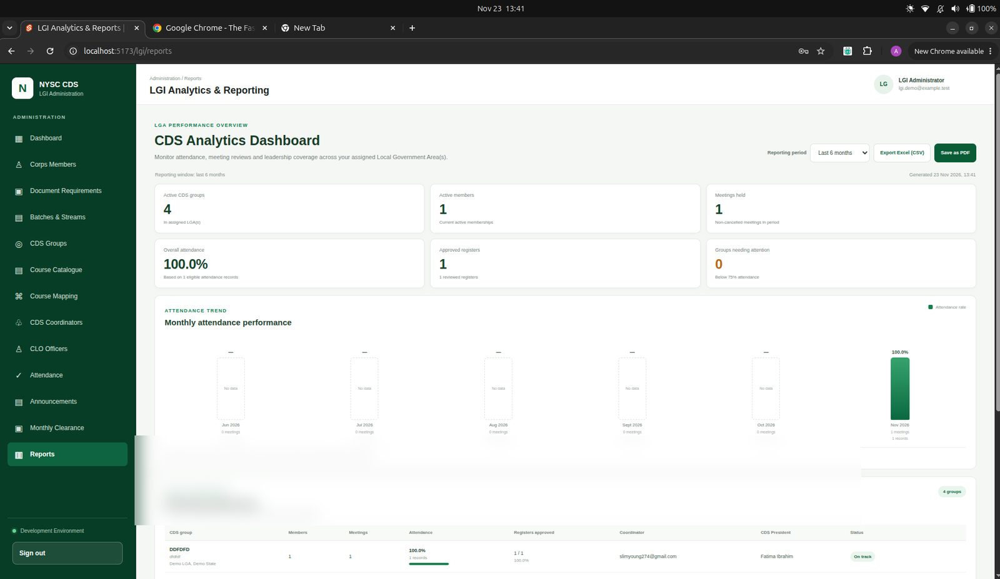

# LGI Administrator Guide

The LGI workspace is available at `/lgi`. LGI access is scoped to the LGA assignment(s) attached to the signed-in account. The API enforces that scope; do not attempt to manage a record outside your authorized LGA(s).

## Dashboard

The dashboard is the entry point for the administrative modules. It links to Corps Members, Batches & Streams, CDS Groups, Course Catalogue, Course Mapping, CDS Coordinators, CLO Officers, Attendance, Announcements, Monthly Clearance and Reports.

## 1. Set up NYSC cohorts

Open **Batches & Streams** to create and maintain service years, batches and streams. These cohort records are used when creating or importing Corps Member records. Use active service-year, batch and stream combinations.

## 2. Create and maintain Corps Member records

Open **Corps Members**.

You can:
- Add an individual Corps Member record.
- Search and filter by member identity, LGA, service year, batch, stream and profile status.
- Open a record to view or edit details.
- Download the CSV template and bulk import member records.
- Export the currently filtered directory.
- Upload a profile photograph through the member form.

For self-service onboarding, a `preloaded` record must contain State Code, Date of Birth, Call-up Number and at least one contact method (email or phone). Contact details are not verified until the member completes OTP onboarding. CSV format, row limits, duplicate handling and photo-storage requirements are documented in [Corps Members](../corps-members.md).

### Clear a registration lock

A member who has exhausted the identity-check allowance is marked **Registration locked** in the directory. Only clear it after checking the member's NYSC identification documents in person.

Select **Clear lock** and confirm the operation. The lock is cleared for that member and the action is recorded. Do not clear a lock simply because the member requests it remotely.

## 3. Manage CDS groups

Open **CDS Groups** to create groups, set their capacity and description, map one or more active courses, and manage their rosters.

The page includes filters for group name, LGA and status. Use **Manage members** to view the roster, add an eligible member, end an active membership or make an authorized course-mapping override with a reason where the UI permits it. Review the group capacity and current membership before making changes. The server enforces one active group placement per Corps Member and the configured capacity.

The **Declined CDS placements** area highlights members who declined an assignment and still need a new group placement.

## 4. Course Catalogue and Course Mapping

The Course Catalogue is a shared reference dataset used across LGAs. An LGI catalogue change is therefore visible beyond the LGI's own LGA. Add canonical courses, aliases and categories carefully; deactivate rather than remove a course already referenced by records.

See [Shared Course Catalogue](../course-catalogue.md) for CSV import rules and normalization.

Course Mapping is used to associate academic courses with eligible CDS groups. Verify mappings before relying on automatic placement.

## 5. Manage Coordinators and CLO officers

### CDS Coordinators

Open **CDS Coordinators** to invite an account, assign one or more groups in your LGA, update assignments, disable/reactivate access and transfer group responsibility. A Coordinator may manage several assigned groups, but each active CDS group has one active Coordinator assignment.

The development UI may display a one-time activation token because an email delivery provider is not integrated in that environment. Share development tokens securely. Production does not return activation tokens in API responses.

For account lifecycle, group handovers, standby Coordinators and audit history, see [Coordinator Management](../coordinator-management.md).

### CLO Officers

Open **CLO Officers** to create a CLO account and select the LGA(s) that may manage that CLO account. The CLO's document-review capability is platform-wide across Corps Members in every LGA. The selected LGA scope determines which LGI administrators can manage the CLO account; it does not narrow the CLO's document workspace to only those LGA(s).

You can edit the management scope and pause or restore CLO access. Pausing preserves the account and assignment history.

## 6. Configure and review documents

Open **Document Requirements**. Select an LGA, then create or edit the requirements that should appear on Corps Member and Coordinator checklists. A requirement can be saved as a draft, published/enabled, disabled or removed. Reference samples can be uploaded or replaced.

The current modes are:
- **Manual** — LGI reviews each submission.
- **AI Auto-Verification** — high-confidence AI matches may be auto-verified; uncertain or rejected results can be routed to LGI review.
- **AI + LGI Approval** — AI assists, but the LGI makes the final decision.

Open a submitted file before making a decision. **Mark verified** or **Request resubmission** requires a review note of at least 10 characters. The decision is recorded with the reviewer and timestamp. Approval of one document does not automatically complete the member's profile when other mandatory requirements remain unverified.

Read [Document Verification Workflow](../document-verification.md) for the complete mode, fallback and human-review rules.

## 7. Attendance and monthly clearance

### Attendance reports

Open **Attendance** to view read-only meeting and register reports for your assigned LGA(s). The President records attendance and submits the register; the Coordinator reviews it. The LGI report displays the submitted/reviewed information and audit history; it is not the place to directly edit individual attendance marks.

### Monthly Clearance

Open **Monthly Clearance** to inspect member clearance records for the selected month. The page exposes **Clear**, **Not cleared** and **Reopen** actions, with decision notes and audit history. Use the recorded history to understand previous decisions.

## 8. Reports and announcements

**Reports** provides the LGI Analytics & Reporting dashboard, including active CDS groups, active members, meetings held, overall attendance, approved registers, monthly attendance trend, group performance and groups requiring follow-up. The page supports CSV export and PDF/print output.

Use **Announcements** to publish operational updates. Check the LGA/group targeting, priority and optional expiry before publishing. Published announcements are visible to the applicable recipients in their portal.

## Operational reminders

- Review State Code, Call-up Number and Date of Birth before setting a member record to `preloaded`.
- Do not clear a registration lock without in-person identity verification.
- Keep reference samples and document requirements current.
- Inspect the actual document before confirming an AI recommendation.
- Course Catalogue changes are shared platform-wide.
- Keep member documents and photographs in the private storage configured for the API; do not email or publish document files unnecessarily.
